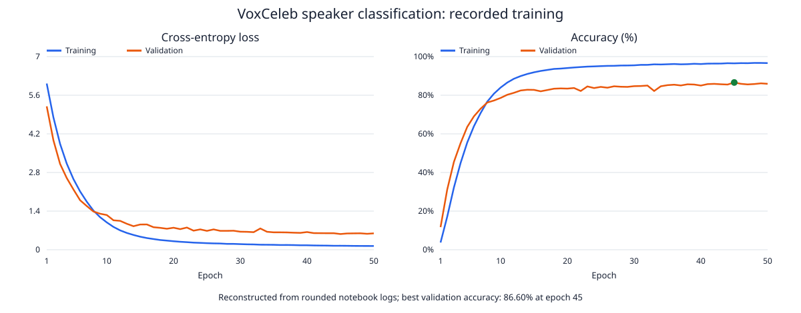
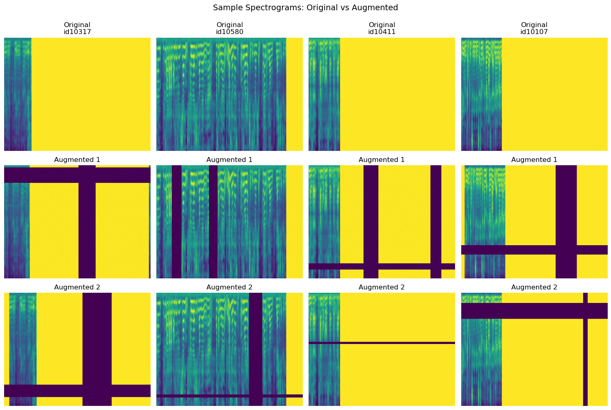
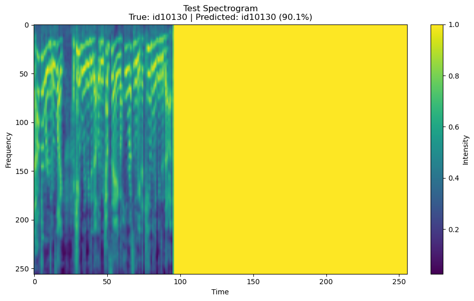

# VoxCeleb Speaker Classification with a VGG-Style CNN

A PyTorch project for **closed-set speaker identification** from pre-extracted spectrograms. A custom VGG-inspired CNN learns to classify 605 speakers from a subset of VoxCeleb1.

## Highlights

- Seven convolution layers with filter widths 32, 32, 64, 64, 128, 128, and 256.
- Frequency/time masking, Gaussian noise, and circular time shifts during training.
- Stratified 80/20 train/validation split, Adam optimization, learning-rate scheduling, gradient clipping, and checkpoint selection.
- **Recorded best validation accuracy: 86.60% at epoch 45.**

This is a custom architecture named VGG16-Lite in the notebook, not pretrained torchvision VGG16. It identifies speakers among the training classes; it does not implement speaker verification or unknown-speaker detection.

## Recorded results

These values are extracted from the notebook's saved outputs. Training and evaluation have not been independently rerun.

| Measure | Recorded value |
|---|---:|
| Available speaker folders | 1,211 |
| Selected speaker classes | 605 |
| Spectrogram samples | 72,766 |
| Training / validation samples | 58,212 / 14,554 |
| Best validation accuracy | 86.60% |
| Best accuracy checkpoint | Epoch 45 |
| Weighted precision / recall / F1 | 0.8717 / 0.8660 / 0.8641 |
| Macro precision / recall / F1 | 0.8645 / 0.8323 / 0.8415 |
| Final training / validation accuracy | 96.64% / 85.91% |
| Trainable parameters | 34,448,893 |
| Completed epochs | 50 |
| Total training time (saved summary) | 318.44 minutes |
| Recorded hardware | NVIDIA RTX 4070 Laptop GPU, 8 GB |
| Recorded PyTorch build | 2.8.0+cu129 |

### Training curves



The original plotting cell failed with `NameError: history is not defined` and contains an empty figure. These curves are reconstructed from the **rounded printed metrics for epochs 1–50**, without retraining. Rounded epoch times sum to 318.48 minutes; the saved summary reports 318.44 minutes from unrounded times.

Download [epoch metrics (CSV)](results/epoch_metrics.csv), [epoch metrics (JSON)](results/epoch_metrics.json), or inspect [saved text outputs](results/training_log.txt).

### Spectrogram augmentation



Extracted directly from the notebook's embedded image. Training augmentation masks up to 40 frequency/time bins, adds noise with standard deviation 0.01, and optionally shifts the time axis.

### Saved prediction example



One validation example is correctly identified as **id10130** with a softmax score of **90.07%**. This score is not calibrated confidence, and one example does not establish general performance. The original figure says “Test Spectrogram,” but the sample was drawn from the validation split.

## Model and training

Each input is normalized per sample to [0, 1] and resized to a single-channel 256 × 256 tensor. Four convolution/pooling blocks reduce the spatial size to 16 × 16, followed by flattening, a 512-unit dense layer, dropout, batch normalization, and 605 output logits. The large dense layer accounts for most model parameters.

| Setting | Value |
|---|---|
| Loss | Cross-entropy |
| Optimizer | Adam |
| Initial learning rate | 0.0001 |
| Batch size | 96 |
| Dropout | 0.5 |
| Seed | 42 |
| Scheduler | ReduceLROnPlateau, validation loss, factor 0.5, patience 5 |
| Early stopping | Validation loss, patience 7 |
| Checkpoint selection | Highest validation accuracy |
| DataLoader workers | 0 |

The saved run completed all 50 configured epochs; early stopping did not trigger.

## Getting started

Use Python 3.10 or 3.11 in a virtual environment. The dependency list is a suggested environment, not a complete lockfile.

```powershell
git clone https://github.com/maishashwathu/VoxCeleb-Classification.git
cd VoxCeleb-Classification
python -m venv .venv
.\.venv\Scripts\Activate.ps1
python -m pip install --upgrade pip
python -m pip install -r requirements.txt
jupyter lab
```

For GPU training, install a suitable PyTorch CUDA build using the [official installation selector](https://pytorch.org/get-started/locally/) before installing the remaining requirements.

Open `voxceleb_training_VGG16_lite.ipynb` and run cells in order. Supply the pre-extracted arrays described in [data/README.md](data/README.md), then set `CONFIG['data_dir']` to their directory. The default spelling is **Spectograms**.

The notebook does not download audio or implement audio-to-spectrogram preprocessing. Raw-audio inference is therefore not available from this repository alone.

## Checkpoint status

**The trained model has not been uploaded yet.** See [models/README.md](models/README.md) for the expected filename, checkpoint structure, class mapping, and loading instructions.

The notebook writes `voxceleb_cnn_lite_gpu.pth` and `class_to_idx.json` when training. Run training only when you intend to create a new checkpoint. Once the original checkpoint is supplied, use its saved class mapping rather than reconstructing labels from a potentially different dataset.

## Recover outputs without training

The extraction utility uses only Python's standard library and the notebook's saved outputs:

```powershell
python scripts/extract_notebook_results.py
```

It exports the two valid embedded PNGs, reconstructs training curves as SVG, and writes rounded epoch metrics and text outputs. It does not require a dataset, GPU, or model file.

## Known limitations

- Only the first 605 sorted speaker folders are selected, rather than a random half of speakers.
- The split is stratified by speaker at the file level. Clips from the same video/session may appear in both partitions; there is no grouped split or separate held-out test evaluation.
- Validation data is reused for model selection. The reported accuracy is validation performance, not an official VoxCeleb benchmark result.
- The original history plotting/export cells failed with `NameError`. Run training first to populate `history`, or use the extraction script for the recorded results.
- The confusion-matrix cell failed with `KeyError: np.int64(407)` because a selected true class was predicted as a class outside the top-ten mapping. No valid confusion matrix is present to extract. Recompute from predictions with an explicit “Other” prediction column, or compute the full 605-class matrix.
- Saved outputs reflect multiple execution states. The final summary incorrectly appends “CPU” to a CUDA device and lists inconsistent output filenames; the hardware outputs and actual save code are used here.
- Spectrogram extraction settings, original arrays, and the checkpoint are absent, so exact reproduction cannot yet be established. Broad uniform regions visible in some spectrograms should be investigated in the upstream preprocessing.
- Training catches and skips runtime-error batches; future runs should audit any skipped batches before interpreting the epoch metrics.

## Repository contents

| Path | Purpose |
|---|---|
| `voxceleb_training_VGG16_lite.ipynb` | Original training and evaluation notebook |
| `assets/` | Extracted figures and reconstructed training curves |
| `results/` | Rounded epoch metrics and saved text outputs |
| `scripts/extract_notebook_results.py` | Reproducible output recovery without training |
| `requirements.txt` | Suggested Python environment |
| `data/README.md` | Expected spectrogram layout and preprocessing notes |
| `models/README.md` | Instructions for adding and loading the checkpoint |

## Data and authorship

Project by Shashwat Jain. VoxCeleb data is not redistributed here. Consult the [official VoxCeleb resource](https://www.robots.ox.ac.uk/~vgg/data/voxceleb/) for dataset access and terms. No project code license has been selected.
